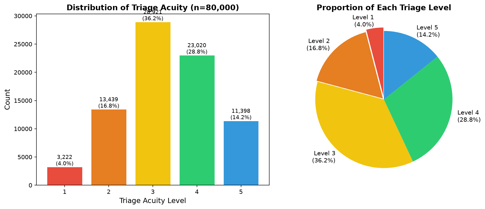
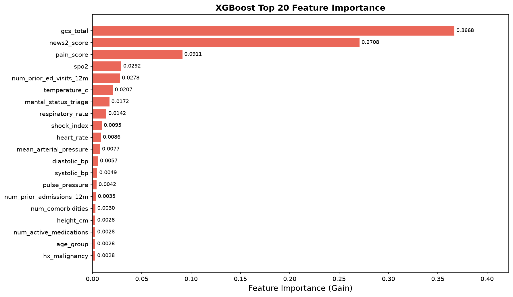
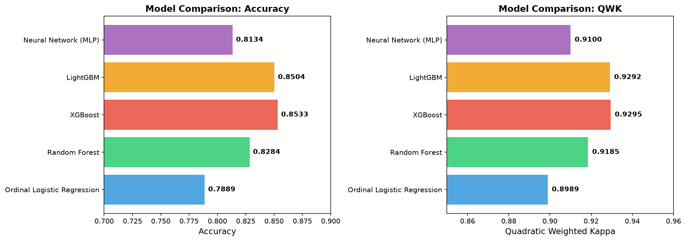
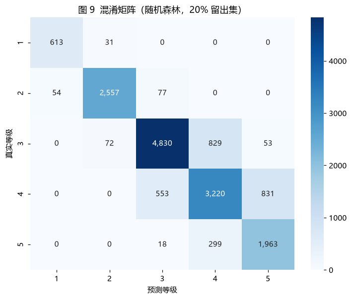
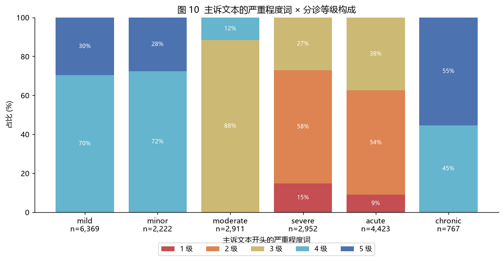

# Triagegeist — 急诊分诊等级预测

把 4 张原始表用 **SQL** 关联成一张分析宽表，先做**字段信号体检**，再用 **5 个模型**做五折交叉验证对比。

最佳模型 **XGBoost：Accuracy 0.8533，QWK 0.9295**。

---

## 1. 问题

急诊分诊要在患者到院后的几分钟内判断病情紧急程度，决定谁先看。国际通行的是 ESI 五级分诊：

| 等级 | 含义 |
|---|---|
| 1 | 需立即抢救 |
| 2 | 危重，需尽快处理 |
| 3 | 紧急，可短暂等待 |
| 4 | 次紧急 |
| 5 | 非紧急 |

分诊判错是有代价的：判轻了延误救治，判重了挤占急救资源。本项目基于 Kaggle 竞赛 **Triagegeist** 的数据，预测患者的五级分诊等级。

## 2. 数据

| 文件 | 行数 | 列数 | 说明 |
|---|---|---|---|
| `train.csv` | 80,000 | 40 | 训练集，含标签 `triage_acuity` |
| `test.csv` | 20,000 | 37 | 测试集 |
| `patient_history.csv` | 100,000 | 26 | 既往病史（25 个 0/1 字段） |
| `chief_complaints.csv` | 100,000 | 3 | 主诉文本与科室 |

### ⚠️ 前提：这是合成数据，不是真实医院记录

三条判断依据：

1. 竞赛说明标注为 hackathon，未指明真实数据来源；
2. `site_id`、`triage_nurse_id`、`transport_origin` 这类本应杂乱的字段，分布异常规整；
3. **最有力的一条**：除精神状态外，其余所有人口学 / 社会学字段与分诊等级几乎无关（见 3.2）——真实急救数据里，年龄、到院方式、保险类型不可能毫无影响。

这个前提直接决定了结论的边界，见第 5 节。

## 3. 做法

### 3.1 用 SQL 建宽表

4 张表靠 `patient_id` 连接。动手之前先做连接体检：

| 检查项 | 结果 |
|---|---|
| 三张表行数 | 80,000 / 100,000 / 100,000 |
| train 在两张附表里匹配不上的 | **0 人**（全覆盖，不会丢行） |
| 附表中重复的 `patient_id` | **0**（不会行数膨胀） |

结论：`JOIN` 和 `LEFT JOIN` 结果等价，这里仍用 `LEFT JOIN`，是为了将来数据变化时保住行而不是静默丢弃。

建好的宽表 `wide_train` 80,000 × 66、`wide_test` 20,000 × 63。SQL 见 [`sql/01_wide_tables.sql`](sql/01_wide_tables.sql)。

两个必须处理的坑（写在 SQL 注释里）：

- `chief_complaint_system` 在 `train` 里已经有了，主诉表只取 `chief_complaint_raw`，避免重名；
- `patient_history` 里也有一列 `patient_id`，不能用 `h.*` 整表带过来，否则宽表出现两列同名 `patient_id`，建表直接失败。

**表关联由 SQL 负责，pandas 只负责建模**——这也是数据分析岗的真实分工。

### 3.2 字段信号体检（本项目的关键一步）

给每个分类字段算「各类别紧急率（等级 ≤ 2）的极差」：差值大说明该字段真的影响分诊，接近 0 说明是噪声。

| 字段 | 紧急率极差 | 判断 |
|---|---|---|
| 精神状态 `mental_status_triage` | **84.2 个百分点** | 强信号 |
| 主诉系统 | 2.1 | 噪声 |
| 保险类型 | 1.4 | 噪声 |
| 到达方式 | 1.2 | 噪声 |
| 班次 | 0.9 | 噪声 |
| 年龄段 | 0.5 | 噪声 |

各等级的关键指标均值，呈现出完美的单调梯度：

| 分诊等级 | 人次 | GCS | NEWS2 | 休克指数 | 疼痛评分 |
|---|---|---|---|---|---|
| 1 | 3,222 | 6.49 | 13.64 | 1.530 | 8.82 |
| 2 | 13,439 | 11.99 | 10.07 | 1.132 | 7.86 |
| 3 | 28,921 | 15.00 | 2.61 | 0.762 | 4.74 |
| 4 | 23,020 | 15.00 | 0.67 | 0.649 | 3.14 |
| 5 | 11,398 | 15.00 | 0.35 | 0.612 | 1.49 |

更直白的证据：等级 3 / 4 / 5 的 GCS **全部等于 15**，而这三个等级的 NEWS2 上界恰好是 11 / 7 / 4——像卡着阈值切出来的。

分析查询见 [`query.sql`](query.sql)，运行 `python lab.py` 即可复现。

### 3.3 特征工程与建模

- 删掉事后变量 `disposition`、`ed_los_hours`（数据泄露）；
- 数值特征中位数填充，分类特征序数编码，病史 0/1 列保持原样；
- 派生 6 个临床含义明确的特征：MAP 异常、休克指数 ≥ 0.9、NEWS2 ≥ 7、BMI 过轻 / 肥胖、生命体征不稳定计数；
- 5 个模型统一用 **5 折分层交叉验证**，评估指标为 **QWK**（二次加权 Kappa）——分诊等级是有序变量，用 Accuracy 会忽略"错一级"和"错四级"的区别。

## 4. 结果

| 模型 | Accuracy | QWK |
|---|---|---|
| Ordinal Logistic Regression | 0.7889 | 0.8989 |
| Random Forest | 0.8284 | 0.9185 |
| **XGBoost** | **0.8533** | **0.9295** |
| LightGBM | 0.8504 | 0.9292 |
| Neural Network (MLP) | 0.8134 | 0.9100 |

梯度提升树（XGBoost / LightGBM）并列最优，线性模型最弱——说明等级与特征之间存在明显的非线性。

| 分诊等级分布 | 特征重要性 Top 20 |
|---|---|
|  |  |

| 五个模型对比 | 混淆矩阵 |
|---|---|
|  |  |

从混淆矩阵可以看出一件关键的事：**误判几乎全部发生在相邻等级之间**，跨两级以上的错误接近于零。这解释了 QWK 为什么这么高——不是模型"什么都对"，而是**错得都很轻**。特征重要性的前三名是 GCS、NEWS2、疼痛评分，与 3.2 节的体检结论完全吻合。

全部图表见 `figures/`，运行 `python src/figures.py --model` 可一键重新生成。

## 5. 一个值得单独说的发现：主诉文本里藏着标签

`chief_complaint_raw`（主诉原文，10 万条）一开始没进模型。做了一次对照实验（脚本见 [`src/text_experiment.py`](src/text_experiment.py)，逻辑回归 + 3 折交叉验证）：

| 输入 | QWK | Accuracy | 特征数 |
|---|---|---|---|
| 只用结构化特征 | 0.8991 | 0.7888 | 67 |
| **只用主诉文本** | **0.9992** | **0.9982** | 2,854 |
| 结构化 + 主诉文本 | 0.9989 | 0.9984 | 2,921 |

**只给文本就能到 0.999，比全部结构化特征还准。** 这不是模型厉害，是数据的问题。查下去发现：

> 4,949 条不同的主诉文本里，**4,934 条唯一对应一个分诊等级**（99.70%），只有 15 条对应两个等级。

换句话说，**数据生成的过程把标签写进了主诉文本**。同一个"严重程度词"已经把等级范围圈死了：

| 文本开头 | 人次 | 出现过的等级 |
|---|---|---|
| `severe` | 2,952 | 1 / 2 / 3 |
| `acute` | 4,423 | 1 / 2 / 3 |
| `moderate` | 2,911 | 3 / 4 |
| `mild` | 6,369 | 4 / 5 |
| `minor` | 2,222 | 4 / 5 |



**所以本项目的主模型坚持只用结构化特征。** 0.93 是模型的成绩，0.999 是数据集的性质——把两者混在一起报，等于用一个"查表"的结果去冒充建模能力。

如果在真实急诊数据上跑，加文本不会带来这种跃升：真实病人的主诉措辞是自由的，不会像这里一样每种说法唯一对应一个等级。

## 6. 结论

1. **本数据的分诊等级几乎完全由客观生理指标决定**：GCS 卡住了 1 / 2 级的分界，NEWS2 卡住了 3 / 4 / 5 级的分界，精神状态与疼痛评分同向变化。
2. **人口学与社会经济学字段基本没有信息量**（紧急率极差 ≤ 2 个百分点），与真实临床直觉不符。
3. 因此，**QWK 0.93 这个数字的含金量有限**：它反映的是"这份合成数据的标签规则很简单"，而不是"模型能替代真实分诊"。换到真实急诊数据上，性能大概率会明显下降。
4. **主诉文本里编码了标签**（第 5 节）：只用文本就能到 QWK 0.999，所以主模型刻意不采用文本特征。

> 主动划清结论的边界，比报一个漂亮数字更重要。

## 7. 目录结构

```
triagegeist/
├── build_db.py             # CSV → SQLite → 建宽表（一条命令重建）
├── lab.py                  # 跑 query.sql 的小工具
├── query.sql               # 描述性分析查询
├── sql/
│   └── 01_wide_tables.sql  # 建宽表的 SQL（项目核心）
├── src/
│   ├── preprocessing.py    # 特征工程（从 SQL 宽表读数据）
│   ├── models.py           # 5 个模型
│   ├── main.py             # 一键跑全部模型
│   ├── figures.py          # 生成 figures/ 里的全部图表
│   └── text_experiment.py  # 主诉文本实验（发现标签泄漏的那一步）
├── figures/                # 图表
├── submissions/            # 5 个模型的预测结果
├── docs/                   # 竞赛说明
└── data/                   # 原始 CSV（未纳入版本管理）
```

## 8. 如何运行

```bash
pip install -r requirements.txt

# 1. 建库 + 建宽表（生成 triagegeist.db，约十几秒）
python build_db.py

# 2. 描述性分析（可选，结果直接打印）
python lab.py

# 3. 生成图表（加 --model 会额外训练一个随机森林，出图 8、图 9）
python src/figures.py --model

# 4. 主诉文本实验（约两三分钟，跑三组对照模型）
python src/text_experiment.py

# 5. 建模：五折交叉验证 + 生成提交文件
cd src
python main.py
```

> `data/` 里的原始 CSV 未纳入版本管理（数据来自竞赛，不对外分发）。
> 复现请自行下载后放进 `data/`，文件名保持不变即可。

## 9. 局限与后续

- 合成数据，结论不能外推到真实临床场景；
- 主诉文本已单独分析（第 5 节）：它包含标签信息，因此刻意不纳入主模型。真实场景下文本特征该怎么用，需要另外设计；
- `site_id`（5 个取值）和 `triage_nurse_id`（50 个取值）是纯编号，现在被序数编码成 0–4 / 0–49，等于人为制造了"大小关系"；更合理的是独热编码或直接剔除。信号体检显示这两个字段与分诊等级基本无关，剔除代价很小；
- 生命体征存在缺失：收缩压等 5 个字段缺失 5.2%、呼吸频率 3.8%、体温 0.7%，目前一律用中位数填充，未分析缺失机制。

## 10. 作者

**邢怡博** —— 从数据体检、SQL 宽表构建、特征工程，到五个模型的实现与评估，本项目独立完成。
