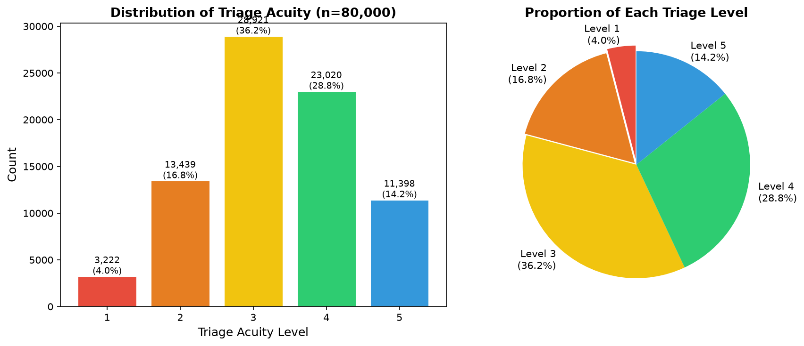
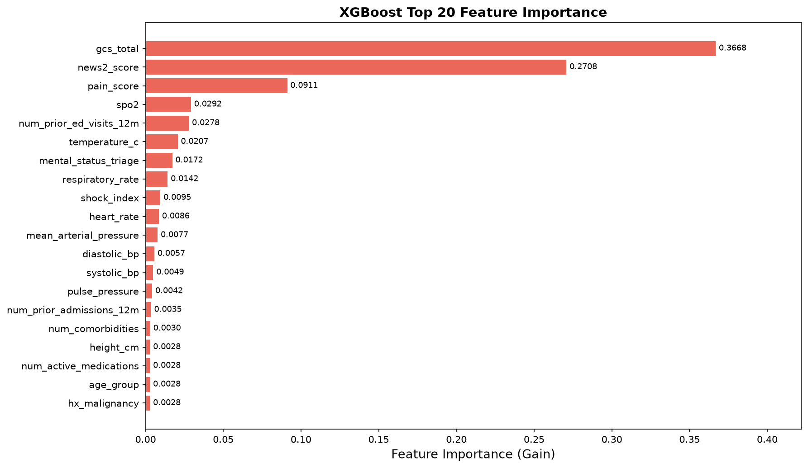
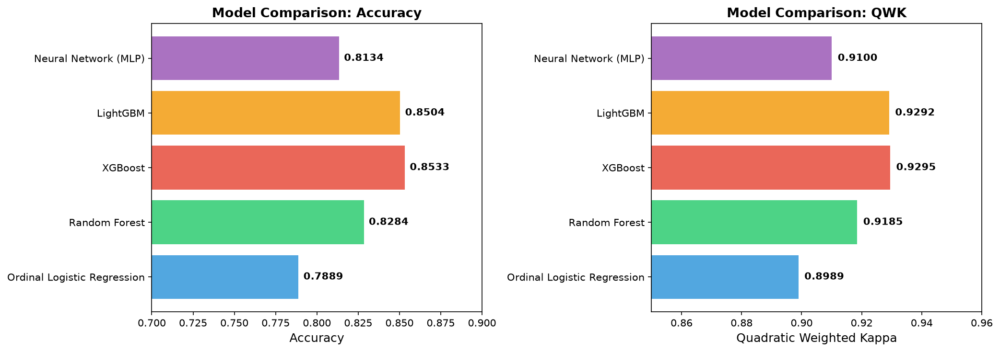
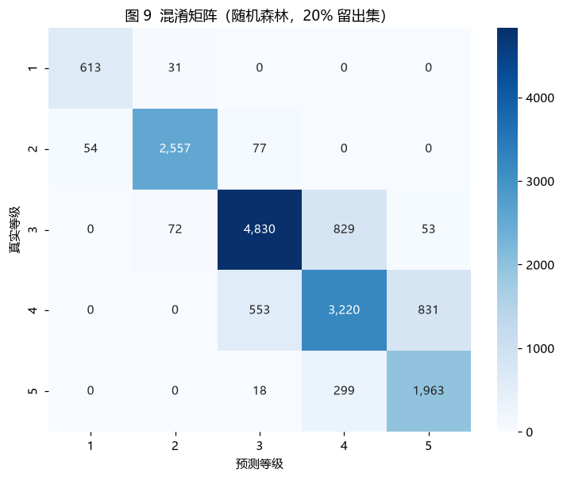
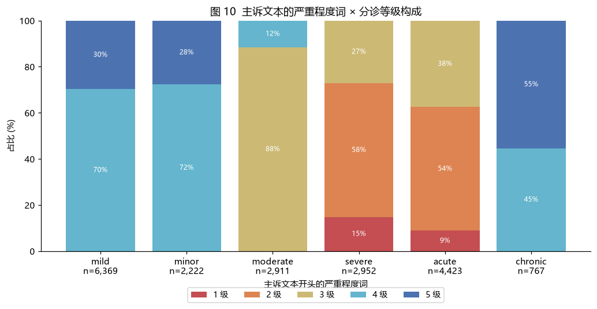

# Triagegeist 急诊分诊等级预测

基于 Kaggle Triagegeist 数据完成的数据分析与预测项目，主要工作包括 SQL 多表整合、数据质量检查、探索性分析、特征工程、模型评估和数据泄漏排查。

| 项目信息 | 内容 |
|---|---|
| 项目类型 | 个人项目（基于 Kaggle 竞赛数据） |
| 技术栈 | SQLite、SQL、Python、pandas、NumPy、scikit-learn、XGBoost、Matplotlib、Seaborn |
| 数据规模 | 训练集 80,000 × 40，测试集 20,000 × 37，两张辅助表各 100,000 行 |
| 核心结果 | XGBoost 五折分层交叉验证：QWK 0.9295，Accuracy 0.8533 |
| 数据说明 | 公开合成数据，不是真实医院记录；结果不用于临床外推 |

---

## 1. 项目背景

急诊分诊要在患者到院后的几分钟内判断病情紧急程度，决定谁先看。国际通行的是 ESI 五级分诊：

| 等级 | 含义 |
|---|---|
| 1 | 需立即抢救 |
| 2 | 危重，需尽快处理 |
| 3 | 紧急，可短暂等待 |
| 4 | 次紧急 |
| 5 | 非紧急 |

分诊误差会影响救治效率。本项目基于 Kaggle Triagegeist 数据预测患者的五级分诊等级，并重点验证数据质量和建模结论的可靠性。

## 2. 数据说明

| 文件 | 行数 | 列数 | 说明 |
|---|---|---|---|
| `train.csv` | 80,000 | 40 | 训练集，含标签 `triage_acuity` |
| `test.csv` | 20,000 | 37 | 测试集 |
| `patient_history.csv` | 100,000 | 26 | 既往病史（25 个 0/1 字段） |
| `chief_complaints.csv` | 100,000 | 3 | 主诉文本与科室 |

### 数据性质

本项目使用的是公开合成数据，不是真实医院记录。这一性质限制了结论的适用范围。

判断依据包括：

1. 竞赛说明标注为 hackathon，未指明真实数据来源；
2. `site_id`、`triage_nurse_id`、`transport_origin` 这类本应杂乱的字段，分布异常规整；
3. 除精神状态外，其余人口学和社会学字段与分诊等级几乎无关，这与真实急诊数据的一般特征不一致。

## 3. 做法

### 3.1 SQL 宽表构建

4 张表通过 `patient_id` 关联。连接前先检查数据覆盖率和主键唯一性：

| 检查项 | 结果 |
|---|---|
| 三张表行数 | 80,000 / 100,000 / 100,000 |
| train 在两张附表中未匹配的记录 | 0 条 |
| 附表中重复的 `patient_id` | 0 个 |

由于两张附表对主表实现全覆盖且主键唯一，`JOIN` 和 `LEFT JOIN` 的结果一致。实现中保留 `LEFT JOIN`，以维持主表行数并降低后续数据变化造成的丢行风险。

建好的宽表 `wide_train` 80,000 × 66、`wide_test` 20,000 × 63。SQL 见 [`sql/01_wide_tables.sql`](sql/01_wide_tables.sql)。

字段冲突处理：

- `chief_complaint_system` 在 `train` 里已经有了，主诉表只取 `chief_complaint_raw`，避免重名；
- `patient_history` 中也有 `patient_id`，因此逐列选择所需病史字段，避免生成同名列。

表关联和基础质量检查在 SQL 中完成，后续特征处理与建模使用 pandas。

### 3.2 字段筛选

对每个分类字段计算各类别的紧急率（等级 ≤ 2），并比较最高紧急率与最低紧急率的差值。差值越大，说明该字段对目标的区分能力越强。

| 字段 | 紧急率极差 | 判断 |
|---|---|---|
| 精神状态 `mental_status_triage` | **84.2 个百分点** | 强信号 |
| 主诉系统 | 2.1 | 噪声 |
| 保险类型 | 1.4 | 噪声 |
| 到达方式 | 1.2 | 噪声 |
| 班次 | 0.9 | 噪声 |
| 年龄段 | 0.5 | 噪声 |

各等级的关键指标均值呈现明显单调关系：

| 分诊等级 | 人次 | GCS | NEWS2 | 休克指数 | 疼痛评分 |
|---|---|---|---|---|---|
| 1 | 3,222 | 6.49 | 13.64 | 1.530 | 8.82 |
| 2 | 13,439 | 11.99 | 10.07 | 1.132 | 7.86 |
| 3 | 28,921 | 15.00 | 2.61 | 0.762 | 4.74 |
| 4 | 23,020 | 15.00 | 0.67 | 0.649 | 3.14 |
| 5 | 11,398 | 15.00 | 0.35 | 0.612 | 1.49 |

数据还显示，等级 3、4、5 的 GCS 均为 15，对应的 NEWS2 上界分别为 11、7、4。该现象与按固定阈值生成标签的合成规则一致。

分析查询见 [`query.sql`](query.sql)，运行 `python lab.py` 即可复现。

### 3.3 特征工程与模型评估

- 删掉事后变量 `disposition`、`ed_los_hours`（数据泄露）；
- 数值特征中位数填充，分类特征序数编码，病史 0/1 列保持原样；
- 派生 6 个临床含义明确的特征：MAP 异常、休克指数 ≥ 0.9、NEWS2 ≥ 7、BMI 过轻 / 肥胖、生命体征不稳定计数；
- 5 个模型统一采用 5 折分层交叉验证，主指标为 QWK（二次加权 Kappa）。分诊等级为有序变量，QWK 会按等级距离加权，更适合该任务。

## 4. 结果

| 模型 | Accuracy | QWK |
|---|---|---|
| Ordinal Logistic Regression | 0.7889 | 0.8989 |
| Random Forest | 0.8284 | 0.9185 |
| **XGBoost** | **0.8533** | **0.9295** |
| LightGBM | 0.8504 | 0.9292 |
| Neural Network (MLP) | 0.8134 | 0.9100 |

梯度提升树（XGBoost、LightGBM）表现最好，逻辑回归表现相对较弱，说明当前数据中的特征与分诊等级之间存在明显的非线性关系。

| 分诊等级分布 | 特征重要性 Top 20 |
|---|---|
|  |  |

| 五个模型对比 | 混淆矩阵 |
|---|---|
|  |  |

混淆矩阵显示，误判主要发生在相邻等级之间，跨两级以上的错误较少。特征重要性排名前三的是 GCS、NEWS2 和疼痛评分，与字段筛选结果一致。

全部图表见 `figures/`，运行 `python src/figures.py --model` 可一键重新生成。

## 5. 主诉文本与标签泄漏

`chief_complaint_raw` 包含 10 万条主诉原文。为判断该字段是否适合进入主模型，使用 TF-IDF 和逻辑回归进行了 3 折交叉验证对照实验（脚本见 [`src/text_experiment.py`](src/text_experiment.py)）：

| 输入 | QWK | Accuracy | 特征数 |
|---|---|---|---|
| 只用结构化特征 | 0.8991 | 0.7888 | 67 |
| **只用主诉文本** | **0.9992** | **0.9982** | 2,854 |
| 结构化 + 主诉文本 | 0.9989 | 0.9984 | 2,921 |

仅使用主诉文本时，QWK 达到 0.9992，高于结构化特征结果。进一步检查发现：

> 4,949 条不同的主诉文本里，**4,934 条唯一对应一个分诊等级**（99.70%），只有 15 条对应两个等级。

该现象表明，合成数据生成过程已将分诊等级信息编码进主诉文本。文本开头的严重程度词与分诊等级范围高度对应：

| 文本开头 | 人次 | 出现过的等级 |
|---|---|---|
| `severe` | 2,952 | 1 / 2 / 3 |
| `acute` | 4,423 | 1 / 2 / 3 |
| `moderate` | 2,911 | 3 / 4 |
| `mild` | 6,369 | 4 / 5 |
| `minor` | 2,222 | 4 / 5 |



为保证评估结果反映结构化特征的预测能力，主模型不使用主诉文本。结构化模型的 QWK 0.9295 与文本实验的 QWK 0.999 分别报告，避免将不同信息源的结果直接合并。

真实世界的主诉文本通常不会以近乎一对一的方式映射分诊等级，因此在真实数据上使用文本特征时需要重新验证。

## 6. 主要结论

1. 在该合成数据中，分诊等级主要由 GCS、NEWS2、休克指数、疼痛评分等生理指标决定。等级 1 和 2 主要受 GCS 区分，等级 3、4、5 主要受 NEWS2 区分。
2. 人口学和社会学字段的紧急率极差大多不超过 2 个百分点，在该数据集上信息量有限。
3. XGBoost 的 QWK 0.9295 仅代表模型对当前合成数据的拟合结果，不能直接外推到真实临床分诊。
4. 主诉文本与分诊等级存在近乎一对一的映射，仅用文本即可获得 QWK 0.9992，因此主模型不使用该字段。

以上结论仅适用于本项目使用的合成数据，不构成临床部署或效果判断依据。

## 7. 目录结构

```
triagegeist/
├── build_db.py             # CSV → SQLite → 建宽表（一条命令重建）
├── lab.py                  # 跑 query.sql 的小工具
├── query.sql               # 描述性分析查询
├── sql/
│   └── 01_wide_tables.sql  # 建宽表的 SQL（项目核心）
├── src/
│   ├── preprocessing.py    # 特征工程（从 SQL 宽表读数据）
│   ├── models.py           # 5 个模型
│   ├── main.py             # 一键跑全部模型
│   ├── figures.py          # 生成 figures/ 里的全部图表
│   └── text_experiment.py  # 主诉文本标签泄漏对照实验
├── figures/                # 图表
├── submissions/            # 5 个模型的预测结果
├── docs/                   # 竞赛说明
└── data/                   # 原始 CSV（未纳入版本管理）
```

## 8. 如何运行

```bash
pip install -r requirements.txt

# 1. 建库 + 建宽表（生成 triagegeist.db，约十几秒）
python build_db.py

# 2. 描述性分析（可选，结果直接打印）
python lab.py

# 3. 生成图表（加 --model 会额外训练一个随机森林，出图 8、图 9）
python src/figures.py --model

# 4. 主诉文本实验（约两三分钟，跑三组对照模型）
python src/text_experiment.py

# 5. 建模：五折交叉验证 + 生成提交文件
cd src
python main.py
```

> `data/` 里的原始 CSV 未纳入版本管理（数据来自竞赛，不对外分发）。
> 复现请自行下载后放进 `data/`，文件名保持不变即可。

## 9. 局限与后续

- 数据为合成数据，结论不能外推到真实临床场景；
- 主诉文本包含标签信息，因此未纳入主模型；真实场景下的文本特征方案需要重新设计；
- `site_id`（5 个取值）和 `triage_nurse_id`（50 个取值）是纯编号，现在被序数编码成 0–4 / 0–49，等于人为制造了"大小关系"；更合理的是独热编码或直接剔除。信号体检显示这两个字段与分诊等级基本无关，剔除代价很小；
- 生命体征存在缺失：收缩压等 5 个字段缺失 5.2%、呼吸频率 3.8%、体温 0.7%，目前一律用中位数填充，未分析缺失机制。

## 10. 项目职责

独立完成 SQL 多表整合、数据质量检查、探索性分析、特征工程、5 个模型的训练与评估，以及主诉文本泄漏实验和项目文档整理。
